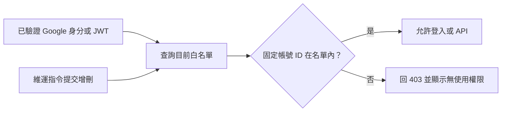

# Google 帳號白名單與基本監測

## 存取契約

只有 `public.auth_allowed_accounts` 中的 Google 固定帳號 ID（`google_sub`）可以登入及呼叫原本受 JWT 保護的 API。`email` 只是管理標籤，不作登入時的替代身分。Google token／授權碼仍需先完成 Google 驗證。

兩個登入入口在建立／更新使用者與發出 JWT **之前**查白名單；每次受保護 API 也重新查詢同一張表，沒有程序快取或 TTL。維運交易提交後，下一次權限查詢就生效，所有 Cloud Run instances 共用同一結果；已開始執行的請求不會被取消。既有 JWT 不會因為仍在 7 天有效期內而跳過白名單。

白名單為空一律拒絕（403 `ACCOUNT_NOT_ALLOWLISTED`）；讀取失敗回 503 `ACCESS_CHECK_UNAVAILABLE`，不退回允許所有人。已停用／刪除的使用者仍不能登入。

公開 Radar GET、GET `/health` 與 internal token 排程沿用原契約；本次沒有讓所有公開 API 都變成私人入口，亦沒有加入自動停止流量。



## 首次正式發布：先 migration 和初始化，再部署

正式 API 啟動只做 Alembic head 驗證。**不能先部署新映像，再期待 API 自己建立表或加入管理者。**

1. 取得本次發布確認，依 [GCP 操作手冊](gcp-cutover-runbook.md) 核對正式 DB、可還原備份與既有 migration gate。
2. 以 `financial_prod_migrator` 執行新 revision `bc3d4e5f6a7b`。它只新增空白名單表，沒有刪除／停用既有使用者或搬動歷史資料。
3. 用下列維運指令加入已指定的初始帳號 `tonyliao1994@gmail.com`。它從既有 `users` 記錄找 Google 固定 ID；找不到或身分衝突時停止，不猜測 ID。
4. `list` 確認初始名單只有該帳號，再核准新正式映像部署。
5. 驗收該帳號可登入、未核准帳號收到 403、已移除帳號的舊 JWT 下一個請求被拒絕；確認 internal 排程與公開 Radar 原契約不變。

Migration 在同一交易內收斂新表權限：正式與測試 API 都只有 SELECT，不能 INSERT／UPDATE／DELETE／TRUNCATE，也不能自行核准使用者。重套正式／測試 `configure-*-privileges.sql` 同樣保留此限制，並移除 `PUBLIC` 繼承的權限，避免不含 ACL 的備份還原後重新開放寫入。管理者／migrator 可維護，debug 帳號依既有唯讀預設權限處理。

若部署後須回復舊程式，舊版會恢復「任何 Google 帳號可登入」的行為；這是存取政策放寬，必須另行確認。單純移除白名單資料不會刪掉使用者或投資資料。Downgrade 會刪除白名單表與成員紀錄，先備份名單，並且只在應用已退回相容版本後操作。

## 日後更新：不需發版或重啟

在 repository 的 `backend/` 目錄執行，指令使用 `PYTHONPATH=src` 載入現有程式。使用既有安全的 migrator 連線環境設定 `DATABASE_URL`，並明確設定 `EXPECTED_DATABASE_NAME=financial_research`；Cloud Shell 使用者須先有可用的 Cloud SQL 連線方式。不要在聊天貼連線字串。下列指令不會建立公開管理 API。

```bash
# 查看目前名單。
PYTHONPATH=src uv run python -m ai_stock_sentinel.auth.manage_allowlist list

# 初次加入：預設只顯示 plan_only，不寫資料。
PYTHONPATH=src uv run python -m ai_stock_sentinel.auth.manage_allowlist grant --email tonyliao1994@gmail.com

# 核對計畫中的 email 與 google_sub 後，明確提交。
PYTHONPATH=src uv run python -m ai_stock_sentinel.auth.manage_allowlist grant --email tonyliao1994@gmail.com --apply

# 移除成員：同樣先預覽，再加 --apply 提交；只刪白名單會員資格。
PYTHONPATH=src uv run python -m ai_stock_sentinel.auth.manage_allowlist revoke --email person@example.com
PYTHONPATH=src uv run python -m ai_stock_sentinel.auth.manage_allowlist revoke --email person@example.com --apply
```

既有使用者可依 email 查出已記錄的 Google ID。從未登入的新帳號，必須先確認其 Google `sub`，再以 `grant --email person@example.com --google-sub CONFIRMED_GOOGLE_SUB` 預覽並提交；不要把任意 email 或未驗證 token 的內容當作 Google 身分證明。API 永遠不會因為 email 相同，就自動綁定另一個 Google ID。

變更是參數化 SQL，單一交易提交；重複 grant／revoke 可安全重做，不會產生新使用者、改動其他資料或自動重試失敗的寫入。輸出會顯示計畫／結果與帳號標籤，不輸出 DB URL、密碼或 token。誤移除可經同一維運權限重新加入；既有有效 JWT 隨後也能再次通過檢查。

## 基本監測：觀察與通知，不自動停機

Cloud Run 原有 request count、latency、5xx、CPU 與 memory 指標繼續使用；容器新增不含 email、Google ID、token 或請求內容的拒絕／讀取失敗事件。

在個人 GCP 專案的 Logs Explorer 使用下列查詢：

```text
resource.type="cloud_run_revision"
resource.labels.service_name="financial-research-prod"
resource.labels.location="asia-east1"
(textPayload:"auth_access_denied" OR textPayload:"auth_access_check_unavailable")
```

登入入口的 4xx（包含未授權帳號、無效 token 與格式錯誤）可另查：

```text
resource.type="cloud_run_revision"
resource.labels.service_name="financial-research-prod"
log_id("run.googleapis.com/requests")
httpRequest.requestMethod="POST"
httpRequest.requestUrl=~"^https://[^/]+/auth/google(/code)?([?].*)?$"
httpRequest.status>=400
httpRequest.status<500
```

如要建立 Email 告警，可將這些查詢分別建立 counter 日誌指標，再設定 Monitoring 通知管道：登入 4xx 暫以 5 分鐘內 20 次、白名單查詢失敗以 5 分鐘內至少一次作為起始門檻。先核對實際流量與日誌／告警費用；這些是建議起始值，不是已驗證的安全界線。只用固定事件或路徑分類作指標，不把每個 IP 或 Google ID 放入 metric labels。

本次程式變更提供事件與查詢，**不會自動建立 Monitoring 日誌指標、Email 通知或告警政策**。正式套用與通知對象需另行確認；現有內建指標可直接查看。白名單無法阻止匿名請求到達 Google 驗證入口，若日誌顯示有濫用，再針對該入口加入限流。
