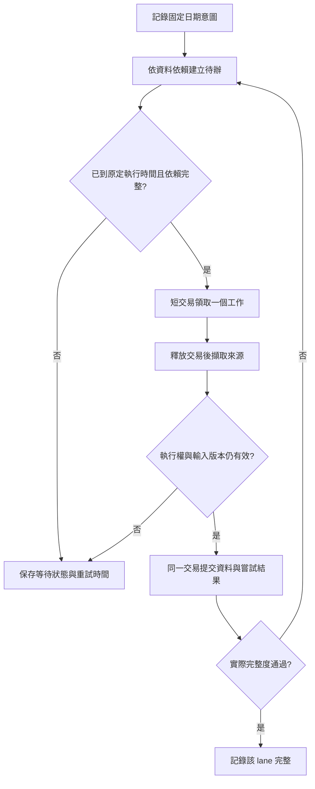

# Daily Radar 完整度與續跑契約

Daily Radar 的執行狀態、當日發布、兩種歷史 validation 與輔助資料分別判讀。HTTP 成功、工作已排入或 cursor 結束，都不能單獨代表資料完整。

## 第一階段：完整度查詢

`GET /internal/daily-radar/readiness?market=TW&run_date=YYYY-MM-DD&lookback_days=365` 使用既有 internal token，純讀 DB，不呼叫 provider。日期必填；lookback 允許 1–1095 天，回應明列樣本起始日。回應包含：

- `scoring`：目前 prepared inputs 能否通過必要 refresh、開市證據、同日完整 raw data 與 market context 檢查。合法且有證據的短歷史仍交給既有 prefilter 排除。
- `publication`：該日 canonical public run、狀態及候選數。已發布不代表目前待重算輸入或歷史 validation 完整。
- `validation.signal_close` / `validation.next_open`：逐一盤點樣本範圍內 canonical candidates 的 5、10、20、40、60 日窗口，區分已驗證、有效 terminal、未成熟、未知成熟度、缺結果、日期錯誤、待補及缺診斷。next_open 僅含 selected 與 comparable shadow，沿用既有研究範圍。
- `auxiliary`：AVWAP 與 managed raw data 的獨立狀態。兩者不是 scoring 必要 refresh。
- `data_ready`：當日 completed publication、目前 scoring prerequisites 及兩種 validation 都完整。不是所有歷史日期的無範圍保證，也不包含 auxiliary 完整度。

沒有完整涵蓋樣本的官方交易日證據時，缺失窗口是 `unknown_maturity`；不以價格序列的筆數證明未成熟。signal_close 已 validated 的首次觀察仍核對診斷版本、origin 及診斷是否可用；repeat 不重複要求首次觀察診斷。`gaps` 最多回傳 100 筆，計數涵蓋完整樣本並標明截斷。

公開觀察診斷與兩種 validation 的 pool 統計，只有在可信日曆涵蓋信號日至查詢截止日、且未滿指定交易日數時，才將缺結果或已保存的 `skipped / window_not_mature` 歸為未成熟。窗口成熟後，舊 `window_not_mature` 重新列為待補缺口；其他失敗、已驗證結果及缺診斷不因較窄日曆而被隱藏。此分類只影響讀取，不改寫歷史結果。

Legacy 的 signal_close／next_open 驗證在收集階段凍結完整 candidate／origin revision 與各窗口結果的 preimage（包含不存在的結果），取資料時不持有接受交易。接受時依 relation → result → prepared 的順序鎖定，在短交易內重新核對 canonical candidate、輸入版本、結果版本與計算截止日，再以 SAVEPOINT 原子保存結果與日曆。輸入變更回 HTTP 409 `validation_inputs_changed`，結果變更回 `validation_results_changed`，一般驗證遇到較新截止日則回 `newer_validation_result_preserved`；整批不寫入，也不回 `completed`。重跑須重新收集現況，正常且版本未變的 range 重算仍允許；已審核歷史覆寫仍走既有補修流程。Durable worker 保留原本的 lease 與接受版本保護。

Workflow 以不同 lane 回報 publication、signal_close、next_open；repair 最後仍對整體完整度檢查。可讀取摘要與保存的 JSON 追查缺口，而非將 validation 缺口誤判為當日 scoring 失敗。

Legacy validation runner 的 `completed` 也需要同日共用 readiness 的該 basis 為 ready；零 current skips 或零剩餘 retryable 不能代表完整。舊報告出現 `validation_input_unverified` 時直接回報 `needs_review`；其他 readiness 缺口回報 `readiness_not_ready`，保留完整 readiness JSON 供追查。唯讀請求使用剩餘 basis 預算、上限 180 秒，失敗不沿用暫定成功；錯誤另存 `readiness_error`，保留已成功 POST 的寫入筆數與來源診斷，且另一種 basis 仍獨立執行。原 workflow 最後的 readiness gate 保留不變。

POST helper 一旦回傳解碼內容，就先封存 `validation_response`，早於期限 context 結束及總預算／schema 檢查。`validation_response_received` 區分是否取得可封存回應；即使內容是 JSON null 或無效 shape 也保留，不能據此推論 server 是否已提交。validation 失敗另記 `validation_error`，readiness 失敗另記 `readiness_error`，均只保存錯誤型別與必要 HTTP status；全部證據沿用 token 遮罩。每個 attempt 重新初始化，不攜帶前次回應，任何逾時或驗證失敗仍不算完成。

Durable executor 因來源版本漂移而拒絕結果時，domain 寫入仍全部 rollback；只在 claim 的 lease、input revision 及期限仍有效時，於 work 與 attempt 同步保存本次 `source_observations`、`source_dependencies`、`source_captured_count`。`source_rejection` 只包含固定 reason、request hash、預期與實際 snapshot SHA256（來源不存在時 actual 為 null），不保存任意例外文字，也不合併上次嘗試的診斷。已持久化的來源快照保留，重試時間與新 owner 的保護不變。

來源延遲與 transport 失敗等待來源；預算用盡續跑；價格衝突保留證據待裁決；缺診斷與日曆問題走指定修復。不能將未知資料改成 terminal 來取得完整狀態。`adjusted_history_changed` 提供第一筆衝突日期、欄位及兩側價格；完整歷史檢查與容差不變。

## 第二階段：來源快照與輸入版本

新增 additive migration `cd4e5f6a7b8c`：`radar_source_snapshots`、`radar_input_manifests`、`radar_run_inputs`。備份 allowlist 同步納入。預設 `DAILY_RADAR_SOURCE_SNAPSHOTS_ENABLED=false`；必須完成正式 migration、後端部署及核准的切換後才啟用。

官方報表、Yahoo 公司行動回應及標準化未還原研究行情以 request、SDK／擷取版本、payload hash、擷取與到期時間保存。有效快照跨 HTTP 請求重用十分鐘；到期重抓產生新觀測，不覆寫原內容。擷取不代表資料完整：空報表、日期／標的錯誤仍由既有 consumer 拒絕，transport 失敗不保存成空資料。原始回應不保存認證參數。官方行情仍是未還原價格，不能直接取代技術指標的還原價格。

技術計算實際採用的還原 OHLCV 歷史另存快照，包含完整 OHLC 與缺值；既有補抓、還原基準與整段歷史核對保持不變。歷史已有的缺診斷資料不因啟用此功能而自動補齊。

DB-only scoring 在計算前凍結 records、market context、背景籌碼、歷史觀察、AVWAP、策略版本、候選上限與 prepared context。manifest 與 run 關聯和 publication 同一交易提交。相同輸入只重用目前 canonical completed run；舊修訂不能復活。來源／輸入變更建立新 manifest 與新 run，原結果保留。與歷史 repair 採一致的 relation → row 鎖定順序，外部 HTTP 不在 publication 交易內執行。

readiness 在開關啟用後比較目前 inputs fingerprint 與已發布 manifest，並核對實際 selected candidate 與整份輸出的筆數。輸出缺列時不能重用原 run，會保留舊結果並重建新修訂。舊發布沒有 manifest 時明列 `legacy_unrecorded`；不拿今天資料替舊結果補造來源證明，也不宣稱新輸入已發布。查詢仍完全唯讀。單次 `/run` 也先擷取 technical evidence，再寫 AVWAP／籌碼，避免小連線池在來源保存時耗盡。

來源快照及 manifests 不提供更新／刪除 API，讀取時驗證 hash；來源資料修訂只能新增觀測。正式回滾優先關閉開關並保留證據表。Migration downgrade 僅供隔離驗證；正式刪表會刪除證據，需要另外的資料處置授權。

## 核准的第三階段

第三階段保存來源依賴、待辦與嘗試紀錄，短交易領取工作、外部 HTTP 不占用交易，以到期時間與執行權版本控制有界續跑及冪等提交。沿用 Actions、Cloud Run、Cloud SQL，不新增 queue service。GitHub concurrency 僅負責互斥，不能取代持久工作紀錄。

正式 migration、部署及歷史補修分別授權。歷史補修沿用 `daily-radar-history-repair-runbook.md` 的 manifest、前後像、CAS 及 rollback 保護；部署不會自動補寫歷史結果。

## 第三階段：持久工作與有界續跑

Additive migration `de5f6a7b8c9d` 新增 `radar_jobs`、`radar_work_items`、`radar_job_work`、`radar_work_attempts`，並為來源快照增加可查詢的 SDK 區間欄位／索引。舊資料不回填，不改寫既有 validation。備份 allowlist 包含全部新表。

`POST /internal/daily-radar/jobs` 只接受明確 `run_date`、TW market 與 lane（publication、signal_close、next_open、auxiliary）。同一意圖重複送出只取回同一工作；202 表示已記錄，沒有宣告資料 ready。每次 `POST /jobs/{id}/advance` 最多執行一個單位，HTTP 回傳後沒有背景工作。`GET /jobs/due` 只回傳持久紀錄內的日期，週末及跨午夜不改成今天。`GET /jobs/{id}` 顯示各 lane 狀態／原因計數、`intent_complete`、`data_ready` 與最後完整度查核時間；即時完整度仍以 `/readiness` 為準。API 不回傳 managed raw data 的分析標的清單或任意 provider 回應。

上市／上櫃來源分開保存待辦，OHLCV、lending、full margin、AVWAP 與 managed raw data 依標的領取；兩種 validation 依 candidate、basis、版本與完整窗口建立待辦。已成熟的同一窗口在後續日期共用，回溯請求不使用較晚截止日的計算。未知官方日曆先取證；休市證據只略過當日 publication，不取消歷史 validation。正常窗口沿用既有 evaluator、ownership guard 與完整度分類。

領取使用短交易與 PostgreSQL `FOR UPDATE SKIP LOCKED`。領取後先 commit，HTTP 不占用該交易；接受結果時重新核對 DB 時鐘、lease token、到期時間、input revision、prepared generation／canonical candidate 與日曆。資料寫入、work 狀態與 attempt 完成同一交易提交。重建 universe 後淘汰舊 generation，其他標的技術 track 更新不會改變 generation。過期執行者不能提交或重置新執行者的狀態。relation 鎖順序維持與歷史 manifest repair 一致。

來源 request 與 provider gate 也保存 lease、退避與 `Retry-After`。官方市場共用報表、SDK 研究／還原行情與供應鏈標準化結果可跨請求重用；標準化結果仍只是擷取證據，consumer 會重跑日期、標的、完整性與 basis 檢查。SDK 覆蓋區間可供較小窗口重用，但回傳資料裁切到精確請求日期。technical refresh 的完整還原歷史另存，不以官方未還原價格替代。FinMind 認證參數不進入快照 request。

價格衝突保留為 `needs_review`。有來源參照時，只在來源到期後重查來源 hash；相同內容不重跑完整窗口，hash 改變才喚醒 evaluator。日期錯誤、舊 validated 結果缺診斷、已審核 rights／history repair 仍由既有 manifest／CAS 流程處理。內部程式錯誤列為 `failed_internal`，不藉由無限重試或放寬檢查取得成功。未完成窗口和 optional 工作在後續觸發續跑。

原 cron 時間保留，包括下一日 00:30 才可 scoring。新增每 30 分鐘的 resume trigger，沒有今天是否開市的前置 gate。開關關閉時保留既有流程；開啟時由新 driver 記錄／推進意圖，23:50 validation、00:30 publication、07:00 repair 仍用獨立 readiness deadline 判定失敗。一般早期 enqueue／advance 成功只表示已記錄或有進展。

Durable driver 可用 `--known-validation-gaps` 讀取已審閱的 `radar-known-validation-gaps-v1` 檔案。檔案包含盤點截止日 `as_of_date` 及當日由唯讀 readiness 以 `include_all_validation_gaps=true` 回傳的 `gaps`。已知窗口依候選版本、日曆、目標日、原因及缺口結果版本精確比對。完整比對時，已知且相同的缺口仍列在 JSON 摘要，`readiness_deadline_passed` 仍為 false。新增、改變、無法完整比對的缺口，以及發布或內部工作失敗，仍讓 driver 非零退出。未傳入清單的執行保留嚴格告警。

### 切換與回滾

1. 先完成備份與經核准的正式 migration，驗證新增表、SDK 索引及既有金融資料；正式 migration／部署不由本機驗證代替。
2. 部署後先保留 `DAILY_RADAR_DURABLE_EXECUTION_ENABLED=false`；確認 `/capabilities` 的 migration 狀態，再經核准啟用 backend 的 source snapshots 與 durable execution 開關。
3. 確認 capabilities `enabled=true` 後，再將 GitHub Actions repository variable `DAILY_RADAR_RELIABILITY_ENABLED=true`。未就緒會 fail closed，不會偷偷回到舊流程。需另行核准的 production 補跑仍使用明確日期。
4. 回滾先關閉 Actions variable，再關閉 backend durable 開關；保留待辦、attempt、來源快照與輸入 manifests，避免刪除恢復證據。已完成工作不因切換被當成整體完整。

本機驗證涵蓋 SQLite 回歸、實際 PostgreSQL 17 的 migration／競爭領取／過期結果回滾、來源去重與節流，以及斷線後兩種 validation 的實際提交。這些證據不代表正式環境已 migration、切換或補修。

### 本機交付驗證（2026-11-09）

第三階段完整 gate 為 2,087 passed、1 skipped（44.47 秒），含隔離 PostgreSQL 17 的 migration、競爭領取、舊快照鎖、窗口續跑、CAS 與備份還原，以及真正 CLI 對 localhost HTTPS mock 的往返驗證。唯一未執行的是需要指定 exact runtime Docker image 的測試。完成自行 review 與一次完整獨立 review、兩次限定補審；核實並修正 6 項 findings，最後補審無 findings。

返工包含補齊測試的 recovery 攔截、ORM／schema 替身，以及修正窗口 closure 的變數遮蔽。正式部署與歷史資料補修未執行；沒有可比較的任務基準，token usage 未取得，不據此宣稱整體效率提升。

### AVWAP 批次的交易擁有者

AVWAP provider 不 commit 或 rollback 呼叫者的 session；ORM 的 `new`／`dirty`／`deleted` 皆為空，仍可能存在已 flush 但未提交的寫入。批次 refresh 先準備全部 DB 證據與 fresh snapshot 身分，再收集全部行情與 missing／不適用診斷，最後才寫 snapshots。讀取到的 archive 結果轉為純資料，結束讀交易後不再因行情收集而查詢 DB。

`refresh-avwap` 與單次 Radar 的 AVWAP 呼叫入口在已知只讀的 prepare phase 後明確結束交易；durable worker 同樣在取得來源 lease 前準備 archive inputs。共用 refresh 函式保留呼叫者已 flush 的寫入，持久化階段只 flush，commit／rollback 仍由呼叫者負責。回歸會在新 session 重讀已提交資料，核對整批 fresh、missing、reused 狀態與 API 計數，而非只檢查回應筆數。

本次 AVWAP 修正驗證：原問題的 6 個回歸案例先失敗，修正後完整 gate 為 2,106 passed、1 skipped（48.12 秒），包含 PostgreSQL 提交後重讀與無 DB 連線的 fallback；唯一 skip 仍需指定 runtime Docker image。完成一輪乾淨自行 review 與一輪完整 Codex 獨立 review，無剩餘 findings。測試準備另修正 fixture 必填欄位與隔離 socket 路徑，未放寬檢查；production 未補跑，usage 與可比較的任務基準未取得。

既有官方配股衝突補修可回到原窗口截止日：只限同一 candidate、版本與窗口、仍為 `conflicting_price_records` 的原紀錄，且官方配股證據、標的及原 `expected_target_date` 全部相符。自動與明確指定標的的官方補修共用此判定；完整窗口驗證、canonical／candidate／結果版本比對和既有官方證據 guard 仍全部執行。這個例外不能覆蓋已驗證結果，也不能忽略收集後的版本變更。

`backend/scripts/daily_radar_forward_validation.py --source db --write-results` 與 legacy API 共用收集時版本快照和接受鎖定；CLI 在計算後才取得短寫入交易，版本變更時失敗退出，不輸出成功報告。未指定 `--write-results` 的唯讀報告模式保留。

CLI 寫入只支援 TW／TAIEX，必須先讀到涵蓋所有候選信號及計算截止日、無衝突的既存官方日曆。5／10／20／40／60 日窗口依官方交易日固定；價格缺日保留缺口，休市信號不得計入已驗證結果。日曆不足時停止寫入；接受時仍以同一短交易原子保存結果與日曆，日曆衝突或 checkpoint 不可保存時整批回滾，不輸出成功報告。CLI 不自行抓取或補建官方日曆，唯讀與 fixture 報告模式維持原有行為。
