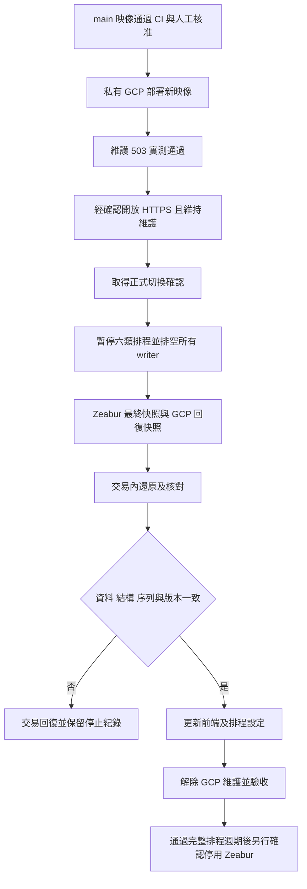

# Financial Research 正式切換操作

本階段只準備入口、main CI/CD、最終還原與回退保護。Zeabur 仍是正式來源；
未取得切換確認前，不更新 Pages／排程 URL、不提交最終匯入、不解除維護、不停止 Zeabur。
既有測試服務已退役，不為這階段重建常駐測試環境。

## 2026-10-19 準備狀態

- 已套用 main 限制：GitHub `gcp-production` 只允許 main，保留人工核准及禁止 admin bypass；
  `GCP_PRODUCTION_DEPLOY_REF=refs/heads/main`、`GCP_PRODUCTION_ACCESS_MODE=private`，WIF 也只接受 main。
- 經另外確認，已解除 Zeabur `financial-research-hae` 的 GitHub 部署來源綁定。
  原部署、網域與資料庫保留；解除後舊 `/health` 實測為 200 / `{"status":"ok"}`。
- GCP 仍為 `financial-research-prod-00002-w4r`，未部署本次新映像；
  invoker IAM check 開啟，無 `allUsers`／`allAuthenticatedUsers`，外部未驗證 `/health` 為 403。
- 本次工具尚待使用者 push／merge main 及核准原生部署；之後才能實測新維護 gate 並確認開放入口。
  最終資料匯入、前端／排程端點切換及停用 Zeabur 都尚未執行。



矩形表示動作，菱形表示檢查；失敗分支不會自行重試或改回網址。
libpq 的 PGHOSTADDR／PGSERVICE／PGSERVICEFILE／PGSYSCONFDIR／PGOPTIONS 覆寫一律拒絕，避免連往不同主機。
若 COMMIT 已送出卻未收到確認，可能已提交，必須先唯讀核對，不能宣稱已回復或重跑。

## main 與權限契約

- `.github/workflows/deploy.yml` 的 GCP 正式 job 只接受 main push，或 main 的人工 dispatch 且勾選部署。
- `GCP_PRODUCTION_DEPLOY_REF=refs/heads/main`；`gcp-production` 仍需帳號持有人核准、禁止 admin bypass，只允許 main。
- `github-production/financial-research-production` WIF 限定相同 repo／owner 數字 ID、main、deploy.yml、push／workflow_dispatch、gcp-production subject。
- `GCP_PRODUCTION_ACCESS_MODE` 明確為 `private` 或 `public`；缺值只接受 private。
  一般 CI 不改 IAM；不授予 deployer setIamPolicy，不代表 migrator，也不執行資料還原。
- main 合併前，確認 Zeabur `financial-research-hae` 的 GitHub 自動部署仍未綁定，執行中的舊後端保持服務。
  避免合併準備工具時連帶重啟舊正式機。
- 使用者自行 push／merge；三組 backend／frontend／PG17 checks 與 gcp-production approval 均保留。
  main 部署 Pages 時仍使用既有 `VITE_API_URL`，合併準備變更本身不會把前端切到 GCP。

## 正式 HTTPS 入口與維護模式

固定服務為 `financial-research-prod`，專案 `financial-research-20261019`，區域 `asia-east1`。
Cloud Run 外部入口與資料庫公開連線是兩件事；不放寬 Cloud SQL 網路或帳號權限。
公開入口沿用應用 Google 登入／JWT、internal token 與既有公開 Radar 讀取契約；CORS 仍只允許 Pages origin。
`APP_MAINTENANCE_MODE=true` 時，除了 GET /health 與 OPTIONS，所有請求都在 DB／provider 前收到 503 + Retry-After。
未設定時既有 Zeabur 行為維持正常；設定成錯字則擋住流量。

部署工具只用 `--update-env-vars` 更新基準設定，完全不提交維護欄位；不把先前讀取的維護值寫回，避免 CI 覆蓋操作人的新狀態。Cloud SDK 會保留服務 resourceVersion 做衝突偵測，衝突時停止而不重試。
`configure-production-entry.py` 預設只列計畫；所有實際變更須使用新的私有 journal。
它先開維護、以原本 IAM 身分實測 /auth/me 的維護回應，再變更公開入口，最後從外部實測同一回應。
舊映像若未實作維護 gate，操作停止在私有入口，不會繼續公開。

以下在個人 Cloud Shell 的 repository 執行。`CUTOVER_IMAGE` 必須是已通過原生 CI 的完整固定 digest；
由部署紀錄核對後設定，不使用 tag／latest。先列計畫：

```bash
cd backend
uv run python ../scripts/gcp/configure-production-entry.py --access public --maintenance true --expected-image "$CUTOVER_IMAGE"
```

公開存取屬於新增存取權，須在實際套用時確認。確認後才執行同一命令並加上
`--apply --journal /home/tonyliao1994/fr-gcp-cutover-entry.json`，環境變數
`CONFIRM_PRODUCTION_ENTRY_CHANGE=yes`；此時仍保持維護，不接正式寫入。
完成後把 GitHub repository 的 `GCP_PRODUCTION_ACCESS_MODE` 改為 `public`，與實際服務狀態一致。
後端 CI 若看到設定與實際入口不同會停止，不會自行改權限。

## 最終資料與停寫窗口

演練的 203.6 秒只涵蓋舊快照匯入，不能當作完整停機估計。
本次採最後快照方案，停寫須涵蓋匯出、傳輸、驗證、交易還原、端點設定及基本驗收；不承諾零停機。

1. 先另行取得正式切換確認。保留原始備份、GCP 現況備份及舊 URL／token 的密碼管理器紀錄，勿貼聊天或 git。
2. 暫停並取消／等待六類 workflow：fundamental-data、daily-radar、daily-radar-chip-context、active-etf-holdings、analysis-forward-validation、monthly-analysis-calibration。
   禁止同時手動 dispatch；記錄已排空的 run ID／作業。再停止 Zeabur 財務後端接受寫入，保留 PostgreSQL 運作。
3. GCP 入口保持維護；等所有已接收請求／背景工作結束，關閉 SQL Studio 及 API pool 連線。
   維護 gate 只阻止新請求，不會中止已開始的工作；還原工具也會拒絕仍有其他 DB 連線的情況。
4. 在 Zeabur PostgreSQL 容器的本機 socket，使用保留的 `snapshot.sh export-financial` 匯出新快照。
   只含 allowlist 財務表，不含 n8n；health 不再匯入。以私有儲存桶傳輸，核對 SHA256SUMS。
5. 從 GCP 同樣匯出一份 `export-financial` 現況快照，作為此次 restore 的 rollback bundle。
   兩份 bundle 各自保存 `manifest.jsonl` 與 `SHA256SUMS` 檔案本身的 SHA-256；從可信任的匯出端取得後核對，不能只相信下載目錄內可一起被改寫的校驗清單。

還原命令在 Cloud Shell 的 backend 環境執行，libpq 環境只指向 Cloud SQL 本機 Unix socket，或
`PGHOST=127.0.0.1` 的既有加密 Cloud SQL Proxy。固定 `PGDATABASE=financial_research`、
`PGUSER=financial_prod_migrator`；憑證由既有 Secret Manager／安全檔案提供，不放 argv。
loopback 模式還需 `CONFIRM_CLOUD_SQL_PROXY=financial-research-20261019:asia-east1:financial-postgres`。

```bash
uv run python ../scripts/gcp/restore-production.py plan \
  --snapshot "$FINAL_SNAPSHOT" --manifest-sha256 "$FINAL_MANIFEST_SHA256" --bundle-sha256 "$FINAL_BUNDLE_SHA256"
```

真正還原須提供四個明確確認，全部為 yes：`CONFIRM_FINAL_CUTOVER_APPROVED`、
`CONFIRM_SOURCE_WRITERS_DRAINED`、`CONFIRM_TARGET_WRITERS_DRAINED`、`CONFIRM_SCHEDULES_PAUSED`。

```bash
uv run python ../scripts/gcp/restore-production.py restore \
  --snapshot "$FINAL_SNAPSHOT" --manifest-sha256 "$FINAL_MANIFEST_SHA256" --bundle-sha256 "$FINAL_BUNDLE_SHA256" \
  --rollback-snapshot "$ROLLBACK_SNAPSHOT" --rollback-manifest-sha256 "$ROLLBACK_MANIFEST_SHA256" --rollback-bundle-sha256 "$ROLLBACK_BUNDLE_SHA256" \
  --journal /home/tonyliao1994/fr-gcp-final-restore.json
```

工具核對 PG17／資料庫／owner、快照校驗碼與完整 allowlist，取得交易鎖後確認無其他連線，
並證明 rollback bundle 與目前 DB 相符。接著只 DROP allowlist 表、不使用 CASCADE、不 DROP DATABASE；
在同一交易還原、恢復原權限，核對每表 rows／內容／columns／constraints／indexes／sequences、
所有序列狀態及 row bounds，並比對目前程式的 Alembic head，最後才 COMMIT。
任何前置檢查不符不刪表，驗證不符不提交；journal 一旦存在就不會自動重跑。
不建立新使用者、不授予 health 存取、不變更 Cloud SQL instance。

## 前端與六類排程切換

最終還原成功且雙邊仍停寫時，依序更新並核對：

| 位置 | 名稱 | 目標 |
| --- | --- | --- |
| Repository variable | `VITE_API_URL` | 經驗證的 financial-research-prod HTTPS URL |
| Repository secret | `ZEABUR_BACKEND_URL` | 同一 GCP URL；保留舊名稱避免改動全部 workflows |
| Repository secret | `DAILY_RADAR_API_BASE_URL` | 同一 GCP URL |
| Repository secret | `DAILY_RADAR_INTERNAL_TOKEN` | 既有 `financial-prod-internal-token` version 1，沿用 GCP 正式值 |

internal token 的輸入與提交由使用者完成，不印出或存入稽核紀錄。先更新 token 再更新兩個 URL；
所有排程仍保持暫停，因此設定更新到一半也不能啟動 writer。
重新建置並部署 Pages，確認產物使用 GCP URL；不能只改變數而沿用舊的靜態 bundle。
Google OAuth 沿用 Pages 的 origin／callback，不需要加入 Cloud Run callback。

解除維護使用相同 entry 工具 `--access public --maintenance false`，除 entry approval 外另需
`CONFIRM_PRODUCTION_CUTOVER_APPROVED=yes`，並使用新的 journal `/home/tonyliao1994/fr-gcp-release.json`。
工具不會替你改 GitHub 設定、恢復排程或停止 Zeabur。

## 驗收與回退

- 實際 Pages 完成 Google 登入；舊 JWT 因新 key 失效而須重新登入。
- ETF 日／區間、2330.TW 分析、用戶寫入與重新讀回正確；確認資料只寫 GCP，其他用戶隔離。
- internal 缺 token／錯 token 被拒絕，正確 token 可執行核准工作；未允許的 CORS origin 被拒絕。
- 手動啟動原生六類 Actions，再恢復排程並觀察完整日週期。
  查同一 run_date、required steps、來源日期、missing lanes、scoring、retry/backlog 與 artifact；
  不能用 HTTP 200 或 workflow 綠燈代替資料有效性，也不放寬既有資料不足條件。
- 通過後另行確認停用 Zeabur 財務後端。共享 PostgreSQL 只有在確認 health 等其他服務無依賴時才可停用。

GCP 尚未新增資料時，先恢復維護、暫停排程，再用以下唯讀檢查對齊最終 source bundle：

```bash
uv run python ../scripts/gcp/restore-production.py verify-rollback \
  --snapshot "$FINAL_SNAPSHOT" --manifest-sha256 "$FINAL_MANIFEST_SHA256" --bundle-sha256 "$FINAL_BUNDLE_SHA256"
```

仍要求停寫確認與固定目標身分。另在 Zeabur 執行 verify-financial 並比對最終快照，
兩側內容、結構、序列均未變才能恢復舊 URL／token、重建 Pages，再啟動舊 writer。
本工具只證明 GCP 的 bundle 一致性，不會直接切換網址或宣稱來源仍未變。
若 GCP 已有新資料，檢查會失敗；保持雙邊停寫，先匯出 GCP 完整財務快照、設計資料補回與核對，
再另行確認回退。禁止直接改回舊 DB 造成新資料遺失或雙邊寫入。

## 本次本機驗證

- 後端完整測試：1896 passed、8 skipped；跳過項目不視為通過。
- PostgreSQL 17 原生驗證涵蓋 migration、正式角色權限及還原；該組為 37 passed、1 skipped。
  最新快照完整性／還原／回退測試另確認 3 passed，包含匯入後內容不符時交易回復及新資料阻止直接回退。
- 部署 shell 的維護狀態競爭回歸、Python 3.9 verifier CLI、shell／Python 語法及文件引用檢查完成。
- 一次完整獨立 review 的三項可行動問題已修正；針對修正與備份完整性保護的後續 review 無新 finding。
- 上述是本機及唯讀線上準備驗證；尚未驗證本次新映像的原生 Actions 部署、公開入口或正式切換後登入／寫入／六類排程。
