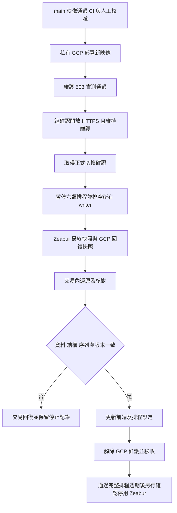

# Financial Research 正式切換操作

GCP 已於 2026-10-19 完成正式資料還原與入口切換，2026-10-20 完成 Google 登入、
ETF、分析與寫入讀回驗收。歷史排程補跑的資料完整性另列下方，不以功能驗收代替資料 ready。
既有測試服務已退役；Zeabur 財務 API 保留暫停狀態及回復資料，共用 PostgreSQL／health 等其他服務保留。

## 2026-10-19 正式切換紀錄

- 已套用 main 限制：GitHub `gcp-production` 只允許 main，保留人工核准及禁止 admin bypass；
  `GCP_PRODUCTION_DEPLOY_REF=refs/heads/main`，WIF 也只接受 main；正式入口開放後，
  `GCP_PRODUCTION_ACCESS_MODE` 已改為 `public`。
- 經另外確認，已解除 Zeabur `financial-research-hae` 的 GitHub 部署來源綁定。
  原部署、網域與資料庫保留；最終停寫時已暫停財務 API，未刪除服務或共用資料庫。
- main `af9f4f0db0f3cdfcc5b9b0ab3c8f8a0ef3d3bd81` 經使用者合併與核准，
  [CI/CD #343](https://github.com/dreamerleolioa/financial-research/actions/runs/39224107843) 完成正式部署。
  固定映像為 `sha256:de15f51cd68f3176a3f3553a62ec6a8977b2777ae932c515392730c7d3e5013b`。
- 最終還原 journal `production/final-restore-20261019.json` 為 `committed_verified`；
  交易提交前核對 39 表、778,889 筆、29 個序列、結構／內容／權限與 Alembic head `ab2c3d4e5f6a`。
  最終來源快照及 GCP 回復快照均保留，禁止重跑已提交的還原。
- 正式 API 為 `https://financial-research-prod-nwnvm3jsoq-de.a.run.app`。
  公開 HTTPS 使用應用 Google／JWT 與 internal token 驗證，維護模式已解除；Cloud SQL 權限未放寬。
  Pages 與兩個排程 URL 設定均已切至此入口；Pages build log 已核對實際注入的 GCP URL。
- **GCP 已有切換後的新寫入。** 回退前須先凍結 writer、匯出 GCP 新資料並對帳；不能直接恢復舊 Zeabur URL。

## 2026-10-20 功能驗收

| 項目 | 實際結果與界線 |
| --- | --- |
| Google 登入 | Pages 使用既有個人 Google 帳號完成登入；重新整理後 `/auth/me` 仍為 200，Cloud Run log 確認請求進入 GCP |
| ETF 單日／區間 | 10/16 快照、個股明細及 9/17–10/16 區間正常；來源日期、持股數、權重差與缺口均可讀回 |
| 2330.TW 分析 | 前端取得分析與技術指標；完整日 K／指標日期為 10/19，盤中狀態有標示 |
| 寫入與讀回 | GCP 10/20 分析 cache ID 166、raw ID 13061；第二次前端分析後 ID、時間與內容雜湊不變，確認持久化與快取讀回 |
| 應用存取 | 無 JWT 的 `/auth/me`、`/analyze` 為 401；internal 缺 token 為 401、錯 token 為 403；正確既有 token 可查 10/19 開市狀態 |
| CORS | Pages origin 預檢 200 且回傳指定 origin；未允許 origin 預檢 400 且沒有 allow-origin |
| DB 除錯權限 | `financial_prod_debug_readonly` 實際以 readonly 連線；無 DML 授權，API/debug 都無 health-tracking CONNECT 權限 |

寫入驗收使用目前仍提供的分析持久化；已下線的關注／持股 UI 沒有重新啟用。
本次未另建第二個 Google 測試帳號；DB 隔離驗證不等同實際雙帳號 UI 驗收。
即時行情 trade date/time 尚無可驗證來源，沿用使用者先前同意不阻擋遷移的範圍。

## 2026-10-20 歷史排程補跑

功能驗收完成後，六類既有工作流程均恢復啟用。10/19 已成功執行的基本面早間刷新不重跑；
週頻 chip context 與月度 calibration 在 10/19 沒有到期作業，只恢復原排程。
歷史 Radar 手動作業固定指定 `run_date=2026-10-19`，不採用補跑當天的預設日期。

| 作業 | 實際結果 |
| --- | --- |
| 法人歸檔 | [Radar #966](https://github.com/dreamerleolioa/financial-research/actions/runs/39351006365) 完成；TW 1,079／TWO 768 筆，錯誤 0 |
| 市場日 K 歸檔 | [Radar #967](https://github.com/dreamerleolioa/financial-research/actions/runs/39351156736) 完成；唯讀 SQL 核對 10/19 TW 1,082／TWO 870 筆 |
| 候選母體／基本面預熱 | [Radar #968](https://github.com/dreamerleolioa/financial-research/actions/runs/39351322681) 建立 prepared run 83、185 檔；後續基本面預熱失敗 |
| ETF 更新 | [ETF #72](https://github.com/dreamerleolioa/financial-research/actions/runs/39351229464) 完成；前端最新資料日 10/19，23/32 檔有資料，9 檔來源未提供，172 筆持股變化 |
| 一般分析前瞻驗證 | [Validation #60](https://github.com/dreamerleolioa/financial-research/actions/runs/39351365180) 完成；as_of_date 10/19、sample_count 8、records_written 0、retryable_skipped_count 0 |
| 借券 | [Radar #969](https://github.com/dreamerleolioa/financial-research/actions/runs/39351664262) 未通過資料 gate；185 筆已保存，46 檔 source_stale／finmind_no_data，errors 0 |
| 完整融資融券 | [Radar #970](https://github.com/dreamerleolioa/financial-research/actions/runs/39351784125) 執行成功；其餘 readiness 以後續資料核對為準 |
| Selected OHLCV | [Radar #971](https://github.com/dreamerleolioa/financial-research/actions/runs/39351845389) 完成；10/19 共 185 筆 final raw，missing_symbols 0 |
| Managed raw data | [Radar #972](https://github.com/dreamerleolioa/financial-research/actions/runs/39351982346) 完成，本次新增 0 筆 |
| 市場背景 | [Radar #973](https://github.com/dreamerleolioa/financial-research/actions/runs/39352055795) 完成，1 筆市場背景；prepared run 狀態為 market_context_ready |
| AVWAP | [Radar #974](https://github.com/dreamerleolioa/financial-research/actions/runs/39352088082) workflow 綠燈；DB step 實際 failed，185 筆保存、38 檔 twse_stock_day_request_failed；此為來源請求失敗，尚未確認 HTTP／TLS／timeout 根因，不能當成有效無資料或完整覆蓋。此步為 optional evidence |
| Radar 前瞻驗證 | [Radar #975](https://github.com/dreamerleolioa/financial-research/actions/runs/39352106438) 雙口徑均完成；signal_close 寫入／驗證 446 筆，next_open 寫入 314、驗證 310、4 筆 stock_split_in_window 終止跳過；兩者本次 retryable_skipped_count 均為 0，next_open 剩餘 retryable window 為 0 |
| AI 證據 | [Radar #976](https://github.com/dreamerleolioa/financial-research/actions/runs/39352339519) API completed、185 筆保存；technical／institutional／margin 缺口均為 0，fundamental 缺口 12、evidence_ready=false；workflow 依資料 gate 失敗 |
| AVWAP 有界重試 | 單次 Cloud Shell TWSE 公開查詢正常後，以 [Radar #977](https://github.com/dreamerleolioa/financial-research/actions/runs/39352799323) 重用既有完成快照、只更新未完成的 38 檔；恢復 7 檔，最後仍有 31 檔 twse_stock_day_request_failed。Cloud Shell 探測不等同 Cloud Run 全面可達，保留兩次結果，未繼續重試或改動 provider |

最終唯讀 SQL 核對 185/185 筆 10/19 raw 為 final；required lending 仍 failed，故未觸發
`run-scoring`，10/19 沒有新增正式 Radar run／候選結果。07:00 複合補修中已完成的子步驟不再重複執行，
保留目前逐步作業及診斷紀錄。前瞻驗證的既存歷史 skip reasons 仍保留，零本次 retryable 不代表歷史資料沒有缺口。

基本面預熱的 Cloud Run request 為 409；唯讀呼叫現行 coverage 邏輯確認 12/185 檔
`insufficient_eps_history`。`radar_fundamental_date_closed` 保護會拒絕隔日補寫成歷史已知證據，
不能把 10/20 首次取得的值回填為 10/19 當時可見。保留失敗與缺口，不放寬 gate，也不因其他作業綠燈宣稱 10/19 完整 ready。



矩形表示動作，菱形表示檢查；失敗分支不會自行重試或改回網址。
libpq 的 PGHOSTADDR／PGSERVICE／PGSERVICEFILE／PGSYSCONFDIR／PGOPTIONS 覆寫一律拒絕，避免連往不同主機。
若 COMMIT 已送出卻未收到確認，可能已提交，必須先唯讀核對，不能宣稱已回復或重跑。

## main 與權限契約

- `.github/workflows/deploy.yml` 的 GCP 正式 job 只接受 main push，或 main 的人工 dispatch 且勾選部署。
- `GCP_PRODUCTION_DEPLOY_REF=refs/heads/main`；`gcp-production` 仍需帳號持有人核准、禁止 admin bypass，只允許 main。
- `github-production/financial-research-production` WIF 限定相同 repo／owner 數字 ID、main、deploy.yml、push／workflow_dispatch、gcp-production subject。
- `GCP_PRODUCTION_ACCESS_MODE` 明確為 `private` 或 `public`；缺值只接受 private。
  一般 CI 不改 IAM；不授予 deployer setIamPolicy，不代表 migrator，也不執行資料還原。
- main 合併前，確認 Zeabur `financial-research-hae` 的 GitHub 自動部署仍未綁定，執行中的舊後端保持服務。
  避免合併準備工具時連帶重啟舊正式機。
- 使用者自行 push／merge；三組 backend／frontend／PG17 checks 與 gcp-production approval 均保留。
  main 部署 Pages 時仍使用既有 `VITE_API_URL`，合併準備變更本身不會把前端切到 GCP。

## 正式 HTTPS 入口與維護模式

固定服務為 `financial-research-prod`，專案 `financial-research-20261019`，區域 `asia-east1`。
Cloud Run 外部入口與資料庫公開連線是兩件事；不放寬 Cloud SQL 網路或帳號權限。
公開入口沿用應用 Google 登入／JWT、internal token 與既有公開 Radar 讀取契約；CORS 仍只允許 Pages origin。
`APP_MAINTENANCE_MODE=true` 時，除了 GET /health 與 OPTIONS，所有請求都在 DB／provider 前收到 503 + Retry-After。
未設定時既有 Zeabur 行為維持正常；設定成錯字則擋住流量。

部署工具只用 `--update-env-vars` 更新基準設定，完全不提交維護欄位；不把先前讀取的維護值寫回，避免 CI 覆蓋操作人的新狀態。Cloud SDK 會保留服務 resourceVersion 做衝突偵測，衝突時停止而不重試。
`configure-production-entry.py` 預設只列計畫；所有實際變更須使用新的私有 journal。
它先開維護、以原本 IAM 身分實測 /auth/me 的維護回應，再變更公開入口，最後從外部實測同一回應。
舊映像若未實作維護 gate，操作停止在私有入口，不會繼續公開。

以下在個人 Cloud Shell 的 repository 執行。`CUTOVER_IMAGE` 必須是已通過原生 CI 的完整固定 digest；
由部署紀錄核對後設定，不使用 tag／latest。先列計畫：

```bash
cd backend
uv run python ../scripts/gcp/configure-production-entry.py --access public --maintenance true --expected-image "$CUTOVER_IMAGE"
```

公開存取屬於新增存取權，須在實際套用時確認。確認後才執行同一命令並加上
`--apply --journal /home/tonyliao1994/fr-gcp-cutover-entry.json`，環境變數
`CONFIRM_PRODUCTION_ENTRY_CHANGE=yes`；此時仍保持維護，不接正式寫入。
完成後把 GitHub repository 的 `GCP_PRODUCTION_ACCESS_MODE` 改為 `public`，與實際服務狀態一致。
後端 CI 若看到設定與實際入口不同會停止，不會自行改權限。

## 最終資料與停寫窗口

演練的 203.6 秒只涵蓋舊快照匯入，不能當作完整停機估計。
本次採最後快照方案，停寫須涵蓋匯出、傳輸、驗證、交易還原、端點設定及基本驗收；不承諾零停機。

1. 先另行取得正式切換確認。保留原始備份、GCP 現況備份及舊 URL／token 的密碼管理器紀錄，勿貼聊天或 git。
2. 暫停並取消／等待六類 workflow：fundamental-data、daily-radar、daily-radar-chip-context、active-etf-holdings、analysis-forward-validation、monthly-analysis-calibration。
   禁止同時手動 dispatch；記錄已排空的 run ID／作業。再停止 Zeabur 財務後端接受寫入，保留 PostgreSQL 運作。
3. GCP 入口保持維護；等所有已接收請求／背景工作結束，關閉 SQL Studio 及 API pool 連線。
   維護 gate 只阻止新請求，不會中止已開始的工作；還原工具也會拒絕仍有其他 DB 連線的情況。
4. 在 Zeabur PostgreSQL 容器的本機 socket，使用保留的 `snapshot.sh export-financial` 匯出新快照。
   只含 allowlist 財務表，不含 n8n；health 不再匯入。以私有儲存桶傳輸，核對 SHA256SUMS。
5. 從 GCP 同樣匯出一份 `export-financial` 現況快照，作為此次 restore 的 rollback bundle。
   兩份 bundle 各自保存 `manifest.jsonl` 與 `SHA256SUMS` 檔案本身的 SHA-256；從可信任的匯出端取得後核對，不能只相信下載目錄內可一起被改寫的校驗清單。

還原命令在 Cloud Shell 的 backend 環境執行，libpq 環境只指向 Cloud SQL 本機 Unix socket，或
`PGHOST=127.0.0.1` 的既有加密 Cloud SQL Proxy。固定 `PGDATABASE=financial_research`、
`PGUSER=financial_prod_migrator`；憑證由既有 Secret Manager／安全檔案提供，不放 argv。
loopback 模式還需 `CONFIRM_CLOUD_SQL_PROXY=financial-research-20261019:asia-east1:financial-postgres`。

```bash
uv run python ../scripts/gcp/restore-production.py plan \
  --snapshot "$FINAL_SNAPSHOT" --manifest-sha256 "$FINAL_MANIFEST_SHA256" --bundle-sha256 "$FINAL_BUNDLE_SHA256"
```

真正還原須提供四個明確確認，全部為 yes：`CONFIRM_FINAL_CUTOVER_APPROVED`、
`CONFIRM_SOURCE_WRITERS_DRAINED`、`CONFIRM_TARGET_WRITERS_DRAINED`、`CONFIRM_SCHEDULES_PAUSED`。

```bash
uv run python ../scripts/gcp/restore-production.py restore \
  --snapshot "$FINAL_SNAPSHOT" --manifest-sha256 "$FINAL_MANIFEST_SHA256" --bundle-sha256 "$FINAL_BUNDLE_SHA256" \
  --rollback-snapshot "$ROLLBACK_SNAPSHOT" --rollback-manifest-sha256 "$ROLLBACK_MANIFEST_SHA256" --rollback-bundle-sha256 "$ROLLBACK_BUNDLE_SHA256" \
  --journal /home/tonyliao1994/fr-gcp-final-restore.json
```

工具核對 PG17／資料庫／owner、快照校驗碼與完整 allowlist，取得交易鎖後確認無其他連線，
並證明 rollback bundle 與目前 DB 相符。接著只 DROP allowlist 表、不使用 CASCADE、不 DROP DATABASE；
在同一交易還原、恢復原權限，核對每表 rows／內容／columns／constraints／indexes／sequences、
所有序列狀態及 row bounds，並比對目前程式的 Alembic head，最後才 COMMIT。
任何前置檢查不符不刪表，驗證不符不提交；journal 一旦存在就不會自動重跑。
不建立新使用者、不授予 health 存取、不變更 Cloud SQL instance。

## 前端與六類排程切換

最終還原成功且雙邊仍停寫時，依序更新並核對：

| 位置 | 名稱 | 目標 |
| --- | --- | --- |
| Repository variable | `VITE_API_URL` | 經驗證的 financial-research-prod HTTPS URL |
| Repository secret | `ZEABUR_BACKEND_URL` | 同一 GCP URL；保留舊名稱避免改動全部 workflows |
| Repository secret | `DAILY_RADAR_API_BASE_URL` | 同一 GCP URL |
| Repository secret | `DAILY_RADAR_INTERNAL_TOKEN` | 既有 `financial-prod-internal-token` version 1，沿用 GCP 正式值 |

internal token 的輸入與提交由使用者完成，不印出或存入稽核紀錄。先更新 token 再更新兩個 URL；
所有排程仍保持暫停，因此設定更新到一半也不能啟動 writer。
重新建置並部署 Pages，確認產物使用 GCP URL；不能只改變數而沿用舊的靜態 bundle。
Google OAuth 沿用 Pages 的 origin／callback，不需要加入 Cloud Run callback。

解除維護使用相同 entry 工具 `--access public --maintenance false`，除 entry approval 外另需
`CONFIRM_PRODUCTION_CUTOVER_APPROVED=yes`，並使用新的 journal `/home/tonyliao1994/fr-gcp-release.json`。
工具不會替你改 GitHub 設定、恢復排程或停止 Zeabur。

## 驗收與回退

- 實際 Pages 完成 Google 登入；舊 JWT 因新 key 失效而須重新登入。
- ETF 日／區間、2330.TW 分析、用戶寫入與重新讀回正確；確認資料只寫 GCP，其他用戶隔離。
- internal 缺 token／錯 token 被拒絕，正確 token 可執行核准工作；未允許的 CORS origin 被拒絕。
- 手動啟動原生六類 Actions，再恢復排程並觀察完整日週期。
  查同一 run_date、required steps、來源日期、missing lanes、scoring、retry/backlog 與 artifact；
  不能用 HTTP 200 或 workflow 綠燈代替資料有效性，也不放寬既有資料不足條件。
- 通過後另行確認退役／刪除已暫停的 Zeabur 財務後端。共享 PostgreSQL 只有在確認 health 等其他服務無依賴時才可停用。

GCP 尚未新增資料時，先恢復維護、暫停排程，再用以下唯讀檢查對齊最終 source bundle：

```bash
uv run python ../scripts/gcp/restore-production.py verify-rollback \
  --snapshot "$FINAL_SNAPSHOT" --manifest-sha256 "$FINAL_MANIFEST_SHA256" --bundle-sha256 "$FINAL_BUNDLE_SHA256"
```

仍要求停寫確認與固定目標身分。另在 Zeabur 執行 verify-financial 並比對最終快照，
兩側內容、結構、序列均未變才能恢復舊 URL／token、重建 Pages，再啟動舊 writer。
本工具只證明 GCP 的 bundle 一致性，不會直接切換網址或宣稱來源仍未變。
若 GCP 已有新資料，檢查會失敗；保持雙邊停寫，先匯出 GCP 完整財務快照、設計資料補回與核對，
再另行確認回退。禁止直接改回舊 DB 造成新資料遺失或雙邊寫入。

## 本次本機驗證

- 後端完整測試：1896 passed、8 skipped；跳過項目不視為通過。
- PostgreSQL 17 原生驗證涵蓋 migration、正式角色權限及還原；該組為 37 passed、1 skipped。
  最新快照完整性／還原／回退測試另確認 3 passed，包含匯入後內容不符時交易回復及新資料阻止直接回退。
- 部署 shell 的維護狀態競爭回歸、Python 3.9 verifier CLI、shell／Python 語法及文件引用檢查完成。
- 一次完整獨立 review 的三項可行動問題已修正；針對修正與備份完整性保護的後續 review 無新 finding。
- 上述是切換前的本機及準備驗證；原生正式部署與 10/20 功能驗收結果見本文前段。
  六類 workflow 已恢復，10/19 歷史補跑仍有已列明的資料缺口；尚未觀察切換後完整例行日週期。
