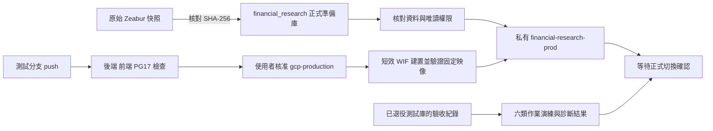

# GCP 正式環境準備

本階段已獲批准建立正式資源與 CI/CD，並在測試庫演練六類資料作業。
正式前端、GitHub 排程與 Zeabur 仍照常運作；切換及停用須另行確認。
測試副本的先前驗收見 [測試遷移紀錄](gcp-test-migration-runbook.md)。
後續 main CI/CD、正式入口與最終快照／回退工具見 [正式切換操作](gcp-cutover-runbook.md)；下方 CI 表格保留前一階段實際設定。
測試專用服務、資料庫、身分、secrets、WIF 與 GitHub environment 已依使用者確認清除；
重建方式與清除後查核也記錄在該文件。正式準備環境及共用 Cloud SQL 保留。

箭頭表示資料或執行順序；演練節點表示保留的歷史證據。
演練時正式準備庫與測試庫曾共用同一台小型 Cloud SQL；測試庫已刪除，正式庫與 health 仍使用該 instance。

## 固定資源與權限

- 專案 `financial-research-20261019`，區域 `asia-east1`，Cloud SQL `financial-postgres`。
- 正式準備庫 `financial_research`；UTF8 / libc / `en_US.utf8`。
- Cloud Run `financial-research-prod` 保持 IAM 驗證，不授予公開 invoker。
- `financial_prod_migrator` 擁有正式準備庫；API 與 debug 無法連測試庫或 health。
- `financial_prod_api` 可讀 33 張 public 表、寫其中 32 張；不能寫 Alembic 版本或備份表。
- `financial_prod_debug_readonly` 可讀 39 張財務及備份表；不能 DML、DDL 或呼叫 nextval；預設 readonly、60 秒 timeout。
- runtime SA `financial-prod-api` 只有 Cloud SQL 連線與六個正式應用 secret。
- migrator SA `financial-prod-migrator` 使用獨立 DB secret；不交給 CI deployer 代表執行。
- deploy SA `financial-prod-deploy` 僅可更新指定正式服務、呼叫健康檢查、寫指定映像庫與 actAs 正式 API SA。
- 不建立 SA JSON key；新密碼及八個 `financial-prod-*` secret 的 version 1 已由使用者自行提交。

## CI/CD

Repository variables：

| 名稱 | 值 |
| --- | --- |
| `GCP_PRODUCTION_PROJECT_ID` | `financial-research-20261019` |
| `GCP_PRODUCTION_DEPLOY_REF` | `refs/heads/codex/gcp-test-migration` |
| `GCP_PRODUCTION_DEPLOY_SERVICE_ACCOUNT` | `financial-prod-deploy@financial-research-20261019.iam.gserviceaccount.com` |
| `GCP_PRODUCTION_WORKLOAD_IDENTITY_PROVIDER` | `projects/918645310958/locations/global/workloadIdentityPools/github-production/providers/financial-research-production` |

四個變數放 repository scope；原有通用 GCP 變數已隨 `gcp-test` 刪除，正式 job 使用獨立的上述變數。
`deploy.yml` 的正式 job 同時檢查事件、固定允許的分支、上述 ref 變數及 `gcp-production` approval。
環境限制 main / 測試分支，reviewer 為帳號持有人，關閉 administrator bypass。
WIF 額外限定 repo/owner 數字 ID、相同分支、事件、workflow 路徑及 environment subject。

使用者自行 push 測試分支後，在 Actions 對應 run 的 **Review deployments → gcp-production** 核准。
不需先合併 main。遠端 run 完成前，本機檢查不能代替 GitHub OIDC/部署成功證據。

部署先檢查既有服務仍私有且使用正確 DB、身分與 secret，再建置固定 digest 映像，
對該映像執行 PG17 驗證後更新服務，最後檢查 IAM、ready revision、100% traffic 與實際 health。
API startup 只驗證 Alembic 版本；不會自動 upgrade。
需要 migration 時，另外使用 `scripts/gcp/migrate-production.sh`，核對備份 SHA-256 並明確確認所有 writer 已排空。
一般 CI 不執行該命令。

## 2026-10-19 副本證據

- 匯入原始快照，沒有使用已經跑過測試寫入的測試 DB。
- GCS object generation `1792378239760345`，165,647,574 bytes。
- SHA-256 `1d902f048b2a89109c0598a4716b09c79c4e7121b7f624b5d454da1d66b30bd8`。
- Cloud SQL import `2b76ebe2-adf3-4928-8264-727500000025`，DONE，無 error；約 203.6 秒。
- 39 張表、778,889 筆資料的內容及 schema 清單與原始副本一致，29 組 sequence 的 last_value/is_called 一致。
- 私有服務初始 revision `financial-research-prod-00001-cpx`，映像 digest
  `b9e3a02dbce395fc93e6dac2defaf7d8e55c0c4171b0f6cf4b06b8cee4634e34`。
- Ready / 100% traffic、正式 API 身分、正式 DB guard、verify-only startup、六個 secret refs@1 均通過查核。
- 無 IAM 的 health 被拒絕；有 IAM 的實際 health JSON 正確。無效應用 JWT 被拒絕，歷史 Radar 讀回一致，Pages origin CORS 通過、未允許 origin 被拒絕，active revision 無 ERROR log。
- 這是準備用快照；Zeabur 後續新增資料尚未同步，不能直接當作切換時的最終資料。

本機後端完整測試 1,874 passed / 7 skipped；另以既有原生 PG17 完成正式 SQL 權限矩陣。
完整 production diff 與演練工具均完成獨立 review；有效 findings 修正並補回歸後複審無新問題。
使用者自行 push 並核准後，[原生 CI #340](https://github.com/dreamerleolioa/financial-research/actions/runs/39212326100)
已對 commit `632a7f9` 通過後端、前端、PG17、測試部署與正式部署；Pages 部署依分支規則跳過。
正式 job 實際走完 WIF、固定映像 PG17 驗證、指定服務更新及 audience-specific health token。
最終正式 revision `financial-research-prod-00002-w4r`，映像 digest
`f09f0a4bb09b040f5c2d557a532314ec5a4f2407d0bdee96ae1bdba5cae261bd`。
部署後再次核對該映像、正式 DB/身分/secret、IAM、100% traffic、歷史讀取、JWT/CORS 及無 ERROR log，均通過。

## 排程演練與正式切換界線

六類為 fundamental-data、daily-radar、daily-radar-chip-context、active-etf-holdings、
analysis-forward-validation、monthly-analysis-calibration，共 18 個 job。
在個人 Cloud Shell 順序執行現有 workflow 的 shell/Python 步驟，使用私有測試服務的 IAM adapter；
具備日期參數的 Radar / forward validation 作業指定 `2026-10-16`，月報指定 `2026-09`。
兩個 chip-context payload 及回應也檢查相同日期；官方基本資料及 ETF registry refresh 沿用各自最新來源，不宣稱全部來源都是歷史 10/16 快照。
這驗證實際 endpoint、provider 與原本 readiness gate；不等同六條 GitHub scheduler、runner 或 artifact upload 的原生執行。

本次 18 個 job 均完成現有步驟檢查，共 319.943 秒。原始 workflow 雜湊與每個 job 的
獨立診斷檔保存在個人 Cloud Shell 的 `fr-gcp-rehearsal-20261019/full-schedules-rehearsal/`。
月報加密後解密，四個檔案的 manifest checksum 全部一致。

| 作業 | 實際證據與限制 |
| --- | --- |
| 基本資料 | 官方資料寫入 3,179 筆；maintenance EPS 回補 60 筆、游標結束且無 provider errors/data gaps。游標結束不代表所有分析資料 ready，Radar pool 另有以下檢查。 |
| Radar evidence | prewarm/finalize 日期皆為 10/16；184 檔 evidence_ready=true，technical/institutional/margin/fundamental lane 全空、errors=0、remaining_gap_count=0。 |
| Radar forward validation | signal_close / next_open 的 as_of_date 都為 10/16；retryable_skipped_count=0，next_open remaining_retryable_window_count=0。此次新增 validated records 為 0；既有 stale_candidate_price / stock_split_in_window 歷史排除仍保留。 |
| Radar scoring | 新 run 166、167 各為 184 universe / 100 selected / 184 saved；84 個診斷全為 prefilter_rejected。選中候選的全部來源日期皆為 10/16；原始 run 163/164 主紀錄與候選指紋未變。 |
| 籌碼 | 日更新 200 筆、週更新 100 筆，日期皆 10/16、errors=0。 |
| ETF | 32 檔均執行，16 更新、15 重用；31 檔有單一來源快照。00415A 尚未公布，回應維持 partial；不把來源缺值改成成功資料。 |
| 一般分析 forward validation | 10/16、8 samples、retryable=0，此次新增 validated records 為 0。 |
| 9 月月報 | 兩類報告及加密流程成功；Radar replay coverage=0，1,424 個 replay inputs 不完整，另有 344 個 validation_result_missing、105 個 stale_candidate_price。一般分析 replay coverage=1，但僅 4 samples。兩類歷史 cohort 均不足所需 6 個月，auto_change_eligible=false，未更新 live scoring。 |

以上通過的是遷移環境的執行與資料契約；月報歷史 coverage 仍不足，不能宣稱已具備策略調參資格。

每個 job 的診斷目錄獨立；失敗保留結果，逾時終止 process group，摘要標示停止且不可自動重試。
月報用臨時金鑰演練加密及解密後 checksum，不更動正式報告密鑰。
HTTP 200、job 綠燈與 cursor 結束均不足以證明資料 ready；須另查同一 run_date、來源日期、缺資料 lane、scoring 與 retry/backlog。

正式切換另須安排所有 writer 暫停、最終快照與驗證，再一起協調
`vars.VITE_API_URL`、`secrets.ZEABUR_BACKEND_URL`、`secrets.DAILY_RADAR_API_BASE_URL` 與 internal token。
目前私有 IAM 入口只供驗收與部署；正式瀏覽器及既有排程不能只改 URL 就直接使用。
切換方案須一併確定應用的外部入口與 internal endpoint 保護，以及排程是否需要限定的 IAM/OIDC transport；公開存取權限尚未套用。
新 JWT key 會要求重新登入。GCP 開始寫入後，回退必須補回新資料，不能只將網址改回舊 DB。
目前沒有執行上述切換、修改正式排程或停用 Zeabur。
