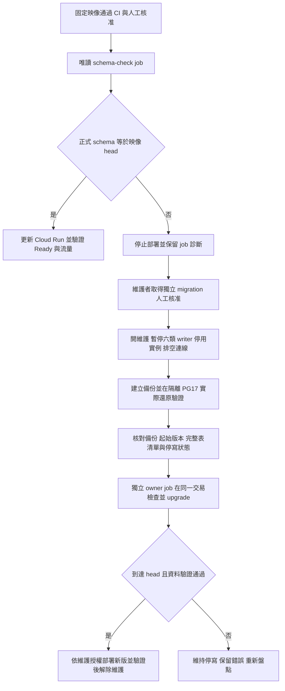

# 正式 schema 檢查與獨立 migration

一般部署保留 `gcp-production` 的人工核准，API startup 保持 `DATABASE_MIGRATION_MODE=verify`。
部署使用已通過 CI PG17 演練的同一固定映像，先執行獨立唯讀 job；只有 schema 完全符合映像 head 才更新服務。
資料庫落後時部署會停止，維護者須另行取得 migration 授權、完成備份及 writer drain，再執行 owner job。
正常部署不會自動進入維護、停排程、備份、upgrade、解除維護或補跑 Radar。



矩形是動作、菱形是檢查。連線失敗、未初始化、未知／分歧版本都阻止部署，不當成需要自動 upgrade。
唯讀 job JSON 區分 `ready`、`migration_required`、`uninitialized`、`incompatible`；列出 current、expected、pending revisions。
非 ready 為非零 exit；不得只憑 job 已啟動宣稱檢查成功。

## 一次性設定：需另外取得正式資源／IAM 授權

本機修正不會建立下列資源。首次使用前由維護者設定，缺漏時 CI 應停止，不能略過 schema gate。
不要先以尚未設定 job 的新版腳本執行正式更新；可先讓 CI 建置及演練映像，保留其固定 digest，再完成此設定並重試部署。

| 身分／資源 | 必要權限與限制 |
|---|---|
| `financial-prod-schema-check@financial-research-20261019.iam.gserviceaccount.com` | Cloud SQL Client；只對 `financial-prod-debug-password` 的 Secret Accessor，不得取得 migrator secret |
| DB `financial_prod_debug_readonly` | 沿用現有 SELECT-only 角色與 secret version 1，不新增 DB 寫入或 DDL 權限 |
| 預先建立的 job `financial-research-prod-schema-check` | `asia-east1`，下方固定設定；CI 只 update 此既有 job，不 create |
| 既有 `financial-prod-deploy` | 此 job 範圍的 `run.jobs.get`、`run.jobs.update`、`run.jobs.run`、`run.executions.get`；此唯讀 SA 範圍的 `iam.serviceAccounts.actAs`。沿用既有 project `run.operations.get` 供 CLI 等待完成；若缺漏，只補此讀取權限 |
| 維護者與 `financial-prod-migrator` | 沿用原本獨立 owner migration 身分；不把 actAs migrator、owner secret 或 DDL 權限交給部署者 |

使用限定此 job 的自訂角色及 resource binding，不授予專案層級 Run Admin／Developer。
上述最小權限仍需在首次設定時核對實際 IAM 與 CLI 回應；本機 fake-cloud 測試不能證明正式 IAM 已完成。
權限依 [Cloud Run IAM](https://cloud.google.com/run/docs/reference/iam/roles) 與
[job 執行文件](https://cloud.google.com/run/docs/execute/jobs)；CLI 使用
[jobs update](https://cloud.google.com/sdk/gcloud/reference/run/jobs/update) 與 `jobs execute --wait`。

經核准後由維護者建立 job（`REVIEWED_IMAGE` 必須是已測試的完整 registry `@sha256:` digest）：

```bash
gcloud run jobs create financial-research-prod-schema-check \
  --project=financial-research-20261019 --region=asia-east1 --image="$REVIEWED_IMAGE" \
  --service-account=financial-prod-schema-check@financial-research-20261019.iam.gserviceaccount.com \
  --set-cloudsql-instances=financial-research-20261019:asia-east1:financial-postgres \
  --set-secrets=PGPASSWORD=financial-prod-debug-password:1 \
  --set-env-vars=PGHOST=/cloudsql/financial-research-20261019:asia-east1:financial-postgres,PGDATABASE=financial_research,PGUSER=financial_prod_debug_readonly \
  --command=python --args=-m,ai_stock_sentinel.operations.schema \
  --tasks=1 --parallelism=1 --max-retries=0 --task-timeout=120 --cpu=1 --memory=512Mi
```

這個 job 不開 HTTP、不公開任何診斷路由，probe 強制唯讀交易及固定 DB／角色／Cloud SQL socket。
schema-check 和 deploy 共用現行 CI concurrency；維護期間不得另行並行部署、手動改 job 或執行其他 DB 維護。

## migration：維護者入口，與部署 CI 分離

1. 先核對唯讀 job 的 current／expected／pending，review 對應 migration 及固定映像。未知或分歧版本先調查。
2. 另行取得正式 migration、停寫及必要部署／解除維護授權。暫停六類 writer、取消或等待既有作業；開維護並設 `--scaling=0`，不得保留可運行的 revision tag。維護 gate 不會停止既有請求，要確認實例已停止、DB 連線已排空。
3. 停寫後匯出 finance-only 一致性快照。使用與當下 schema 相符的 `financial-tables.txt`（落後版本尚未建立的表不能列入；不得靜默漏表）。保留完整 `database.sql.gz`、`manifest.jsonl`、`tables.txt`、`sequence-state.sql`、`SHA256SUMS`、`started-at.txt`。新 exporter 的 checksum 清單包含時間戳；舊四項格式仍可供另行核准的 restore 使用，但不能用來核准新的 migration。由可信匯出端記錄 manifest 及 SHA256SUMS 本身的 SHA-256。
4. 在隔離 PG17 實際還原，使用既有 `snapshot.sh verify-financial`、`compare-manifests.py` 及 `verify-sequences.py` 核對內容、schema、索引及 sequence，保留還原端 manifest。確認 sequence 真實驗證通過後才設定下方 restore confirmation，不能用複製原 manifest 冒充實際還原。
5. 六小時內執行下列入口；逾時、資料重新開放寫入或版本改變，須重新停寫、備份及核准。runtime 也會比對備份表集合與現行 DB 完全相同，拒絕缺表備份。

從 repository root，以既有 GCP 維護操作人 `tonyliao1994@gmail.com` 與可唯讀讀取 Actions 狀態的 `gh` 登入執行：

```bash
export GCP_PROJECT_ID=financial-research-20261019
export GCP_PRODUCTION_ACCESS_MODE=public # 必須符合實際入口
export CONFIRM_PRODUCTION_MIGRATION=yes
export CONFIRM_PRODUCTION_WRITERS_DRAINED=yes
export CONFIRM_BACKUP_RESTORE_VERIFIED=yes
export BACKUP_DIRECTORY=/private/path/to/drained-financial-backup
export BACKUP_RESTORED_MANIFEST=/private/path/to/restored/manifest.jsonl
export BACKUP_MANIFEST_SHA256='<可信匯出端的64位SHA256>'
export BACKUP_BUNDLE_SHA256='<可信匯出端SHA256SUMS檔案的64位SHA256>'
export PRODUCTION_MIGRATION_FROM_REVISION='<核准的12位起始revision>'
export PRODUCTION_MIGRATION_TO_REVISION='<核准映像的12位head>'
bash scripts/gcp/migrate-production.sh "$REVIEWED_IMAGE"
```

這些確認值是維護者核准，不會代替備份檔案與實際停寫檢查。入口驗證實際檔案 checksum、還原 manifest、備份起始版本與受 checksum 保護的時間、服務／IAM、維護模式、零實例及六條 workflow 停用狀態。
owner job 嚴格限制 migrator DSN 為固定 Cloud SQL socket、5432 port、資料庫與角色；拒絕 hostaddr、service、options 等覆寫。它核對版本與備份表集合、零其他 DB 連線，再取得 migration advisory lock 與所有既有表的 DML fence，使用 exporter 的同一 SQL 比對現行資料內容、schema 與 sequence 狀態指紋。即使版本未變，只要備份後曾恢復寫入或資料有變，就必須重新備份及實際還原，不能沿用六小時內的舊快照。
版本／preimage 檢查與 Alembic DDL 使用同一連線與交易；job 的備份／核准期限也綁定快照時間，過期舊 job 不可重放。失敗整筆回復，max-retries=0，不自動恢復寫入或重跑。
`scripts/gcp/table-manifest.sql` 指向 backend 封裝的同一 SQL，避免 exporter 與 runtime 比對規則分歧；若將 exporter 工具複製到獨立目錄，須以 `cp -L` 具體複製 SQL 內容。
其他歷史 migration 若有專屬人工 gate，仍會拒絕缺少核准的執行；需另行 review 對應流程，不能移除該 gate。

成功後先保存 job execution／JSON 診斷，唯讀核對 head、資料、sequence 與權限。服務仍為維護／零實例；一般部署會拒絕此 drain 狀態。
依另外核准的維護部署操作，以同一已測試映像更新服務並恢復原縮放設定，先保持維護驗證新版 Ready、100% 流量及 health，再解除維護並核對 authenticated readiness；或在已核准的新版維護 revision Ready 後恢復縮放，再重試一般部署 gate。
只有這些檢查完成後才按授權恢復原排程，不因 migration 成功就 apply 歷史 manifests、執行 Radar 或放寬完整窗口驗證。

若 job 中斷／提交結果不明，先唯讀核對目前版本與資料，不盲目重跑；本工具不自動 downgrade 或還原 production。共享 instance 的原生備份不可未經確認就地還原，以免影響其他 DB。
