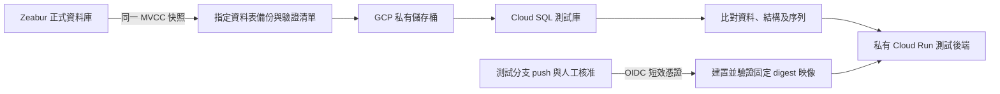

# Zeabur → GCP 測試副本

## 2026-10-19 測試環境已退役

副本與六類作業演練完成後，使用者確認清除測試專用資源。本文件下方保留建立與驗收時的紀錄，
不表示這些資源目前仍存在；正式準備環境見 [正式環境準備](gcp-production-preparation-runbook.md)。

- 已刪除 `financial-research-test`、`financial_research_test`，以及
  `financial_test_api`、`financial_test_migrator`、`financial_debug_readonly` 三個 DB 帳號。
- 已刪除三個 `financial-test-*` 服務帳號、測試 IAM 綁定、七個 `financial-test-*` secrets
  與 `financial-debug-password`，並先停用再刪除 `github-test` WIF pool。
- 使用者完成 GitHub 重新驗證並刪除 `gcp-test` environment；其三個變數隨環境移除。
- CI 移除測試部署 job 與 `deploy_gcp_test` input；一般後端／前端／PG17 檢查、正式部署及人工核准 gate 保留。
  此 workflow 變更目前僅在本機，需使用者自行 push；已刪除的 WIF 與服務身分阻止舊 job 重新建立測試服務。
- 已確認 registry 中三個測試專用 manifests 消失，正式目前與回復映像的六個 manifests 保留。
  已移除 Cloud Shell 的測試前端、兩組排程演練目錄及 17 個具名測試檔案，先將五份驗收紀錄複製到私有稽核目錄。

Cloud SQL 管理 API 因測試庫由 migrator 擁有而拒絕刪除；原工具保留停止紀錄，
改以既有測試 migrator、現成 Cloud SQL Proxy 加密連線，在 `postgres` 確認擁有者及零連線後刪庫，
只接續未完成步驟，沒有新增權限。最後一個映像刪除回報失敗時，唯讀清單已確認三個測試 digest 全部不存在，
因此沒有重試刪除，依實際狀態完成核對及暫存清除。

清除後重新核對正式庫 39 張表、778,889 筆資料、schema／內容摘要與 inventory；
按表名對齊清單後全部一致，29 組 sequence 的 last_value／is_called 也一致。
正式 revision `financial-research-prod-00002-w4r` 及固定映像保持原狀；私有 IAM、實際 health、
應用 JWT 拒絕、歷史 Radar、CORS 接受／拒絕與 active revision 的零 ERROR 紀錄均通過唯讀驗證。
`health-tracking`、共用 Cloud SQL／registry、原始備份、正式帳號與八個正式 secrets 均保留。
共享 OAuth client 與 FinMind token 沒有撤銷；刪除的只是測試 secret 副本。

稽核與逐步進度留在個人 Cloud Shell 的 `/home/tonyliao1994/fr-gcp-retire-test-20261019/`；
原始來源備份的 generation `1792378239760345` 保持不變。Zeabur、正式前端與排程 endpoint 沒有切換。
本機驗證：完整後端 1,875 passed／7 skipped；臨時清理工具 14 項安全測試通過，獨立 review 的有效問題已修正並複查。

未來需要測試時，使用保留的 `scripts/gcp/`、原始快照與本文件重建：先建立隔離 DB／身分／secrets／WIF，
設定新憑證、匯入並核對資料，再恢復專用 CI job／GitHub environment 及人工核准。
不要直接執行下方歷史部署步驟，也不要將測試工具改指向正式庫。
共用 Cloud SQL 仍供正式準備庫與 health 使用，不能因測試退役而刪除整個 instance。

## 範圍與切換界線

本節記錄最初隔離測試副本及部署流程。Zeabur 仍是正式資料來源；前端
`VITE_API_URL`、GitHub 排程使用的正式 URL/token 與 Zeabur 服務維持現況。
正式切換、最後一次停寫快照、排程轉移與停用 Zeabur，必須在驗收後另行確認。

| 來源 | 目標 | 內容 |
| --- | --- | --- |
| `zeabur` | `financial_research_test` | 33 張 public 表（含 Alembic）及 6 張 maintenance_backup 表的結構與資料 |
| `health-tracking` | `health-tracking` | 6 張 public 表的結構；所有表必須是 0 筆，包含 schema_migrations |
| n8n | 不建立 | 已棄用，不匯出、不刪除來源 |



箭頭表示資料或部署來源；正式前端與排程尚未連到 GCP。

## 固定資源與安全界線

- 個人 GCP 專案：`financial-research-20261019`，number `918645310958`。
- 區域：`asia-east1`；Cloud SQL：`financial-postgres`，PostgreSQL 17、db-g1-small。
- Cloud SQL connection name：`financial-research-20261019:asia-east1:financial-postgres`。
- Artifact Registry：`asia-east1-docker.pkg.dev/financial-research-20261019/financial-research`。
- 備份儲存桶：`gs://financial-research-20261019-migration`，禁止公開、uniform access。
- Cloud Run 測試服務：`financial-research-test`，IAM 驗證、min 0 / max 2、每個 instance 5 個 DB connections。
- 遷移 Job：`financial-research-test-migrate`；與 API 分開身分及資料庫憑證。
- 不使用公司本機 gcloud 登入、不將個人帳號金鑰放進 repository、不使用 service-account JSON key。

來源兩個資料庫均為 UTF8、libc、`en_US.utf8`（LC_COLLATE/LC_CTYPE）。
Cloud SQL 管理 API 只接受 template database 的排序規則名稱；要保留來源名稱，
先登入 PostgreSQL `postgres`，**逐句、在交易外**建立空資料庫：

```sql
CREATE DATABASE financial_research_test WITH ENCODING 'UTF8'
  LC_COLLATE 'en_US.utf8' LC_CTYPE 'en_US.utf8' TEMPLATE template0;
CREATE DATABASE "health-tracking" WITH ENCODING 'UTF8'
  LC_COLLATE 'en_US.utf8' LC_CTYPE 'en_US.utf8' TEMPLATE template0;
```

查核 `pg_database` 的 encoding、datlocprovider、datcollate、datctype；不得因建庫
失敗而改用其他語系。已存在的資料庫先盤點，不重建或覆寫。

## 匯出與還原

在 Zeabur PostgreSQL 服務的「指令」終端機，用容器內 PG17 client 與本機 socket；
不是 SQL 編輯器，也不經未加密的公開 PostgreSQL 連線。
將 `scripts/gcp/{snapshot.sh,table-manifest.sql,financial-tables.txt,health-tables.txt}`
放到新私有目錄，輸出路徑必須尚未存在：

```bash
PGDATABASE=zeabur bash scripts/gcp/snapshot.sh export-financial /tmp/financial-snapshot-UNIQUE
PGDATABASE=health-tracking bash scripts/gcp/snapshot.sh export-health-schema /tmp/health-schema-UNIQUE
```

財務腳本用明確 allowlist，拒絕未知 partition、RLS、user trigger/type/function dependency
及跨應用 FK；遇到拒絕先分析，不略過檢查。health 採完整 schema-only dump，包含已盤點的
pgcrypto、commute_mode、2 個函式與 4 個觸發器；拒絕額外資料表與非 public schema，
比對 enum、extension、function 與 trigger 定義。dump 與資料清單共享同一個 readonly MVCC snapshot。
輸出 gzip SQL、每表 row count/content hash/columns/constraints/indexes/sequence options、
實際 dump 內的 setval、SHA256SUMS 與開始/結束 UTC 時間。
序列本身不屬於 MVCC；以 dump 寫出的值核對目標，不能拿仍在寫入的來源序列比較。

經 Zeabur HTTPS 檔案管理下載到私有目錄，先驗證 `SHA256SUMS`，再從個人帳號 Cloud Shell
上傳至私有 bucket 的唯一前綴。不要把 dump、資料清單或連線字串 commit。
原始備份含私人資料，保留至驗收及復原需求確認後才依授權清理。

將 SQL service agent 的 Storage Object Viewer **限於本次備份前綴**，確認權限後才匯入。
財務資料使用 migrator role 作為 object owner。匯入只操作已確認的空目標庫；
部分失敗必須標記，不能重跑同份 SQL 覆寫半成品。需要重建或清除時另行確認。

還原後保持目標沒有 writer，使用相同 PG17 client、連線經 Cloud SQL Auth Proxy：

```bash
PGDATABASE=financial_research_test bash scripts/gcp/snapshot.sh verify-financial /tmp/financial-target-UNIQUE
PGDATABASE=health-tracking bash scripts/gcp/snapshot.sh verify-health-schema /tmp/health-target-UNIQUE
python scripts/gcp/compare-manifests.py SOURCE/manifest.jsonl TARGET/manifest.jsonl
PGDATABASE=financial_research_test uv run --project backend python scripts/gcp/verify-sequences.py SOURCE/sequence-state.sql
```

每個來源分別比對對應目標；確認資料庫 locale、表總數、排除 n8n、health 全表 0 筆。
記錄匯出、傳輸、匯入、驗證各階段耗時；本次副本不會持續接收 Zeabur 新資料。
表內容 hash 用於誤差檢出，傳輸完整性另以 SHA256SUMS 驗證。

## 身分與最小權限

執行前列出具體授權並確認；新密碼由使用者輸入與送出。
資料庫角色均用 SQL 建立為 NOSUPERUSER/NOCREATEDB/NOCREATEROLE/NOREPLICATION/NOBYPASSRLS，
避免管理 API 預設賦予 cloudsqlsuperuser。API、migrator 與 debug 使用不同憑證。

| 身分 | 目標權限 |
| --- | --- |
| `financial_test_migrator` DB role | 測試財務庫與其 schema/object owner，執行人工核准的 Alembic |
| `financial_test_api` DB role | CONNECT、public USAGE、業務表 SELECT/INSERT/UPDATE/DELETE、sequence USAGE/SELECT；Alembic 版本表僅 SELECT；不能 DDL |
| `financial_debug_readonly` DB role | 僅財務測試庫 CONNECT、public/maintenance_backup USAGE、tables/sequences SELECT；預設 readonly；不能 DML/DDL/nextval |
| `financial-test-api` service account | 此專案 Cloud SQL Client；僅讀取下列 API secrets 的 version；不能讀 migrator secret |
| `financial-test-migrator` service account | 此專案 Cloud SQL Client；僅讀 migrator database secret |
| `financial-test-deploy` service account | 指定 registry Writer；指定測試 Cloud Run service 的 Admin/Invoker；僅能 actAs API SA；不接觸 DB secret、正式排程或 migration Job |
| Cloud SQL service agent | 僅本次備份前綴的 Storage Object Viewer；完成後按核准範圍撤銷 |

建立 API/debug grants 時，同時設定 **migrator owner 的 ALTER DEFAULT PRIVILEGES**，
讓日後建立的業務表遵循同一界線；明確撤銷 PUBLIC 的 DB CONNECT/TEMP 與 schema CREATE。
readonly 是實際權限限制，`default_transaction_read_only=on` 只是額外預設，不能代替 REVOKE。
health-tracking 不授予上述 app/debug 身分存取。

對應腳本：在 postgres 執行 `bootstrap-test-roles.sql`，還原時指定 migrator 為 owner；
還原完成後在 financial_research_test 執行 `configure-test-privileges.sql`。
前者使用 psql meta-command，SQL Studio 執行時只貼 SQL 主體，不貼 `\set`。
這些腳本不包含密碼，執行前仍須核對目標專案與實際角色是否已存在。
Cloud SQL 的 postgres 並非真正 superuser；bootstrap 會先授予既有管理員對 migrator 的
SET capability，先完成 CONNECT grants，最後才交接資料庫 owner。失敗須確認交易已回滾再重試。
交接後須以新 owner 補回原管理員的 CONNECT，因 ALTER OWNER 會重寫原 owner 的 ACL；
應用與 debug 的 CONNECT 在交接前設定，驗證須包含原管理員的新連線。

建立 Cloud Run service 的 owner bootstrap 後，再把 service 層級權限交給 deploy SA，
不要為了建立第一個服務而長期給整個專案 Run Admin。
首次 Cloud Build 若採用專用 build SA，只授予本次 source/log bucket 與指定 registry 寫入；
不得直接授予 Editor。Cloud Build 映像亦須以 digest 固定並通過容器測試才部署。

API Secret Manager secrets（部署固定讀 version `1`）：

- `financial-test-database-url`：API DB role、目標 financial_research_test，Unix socket 指向本專案 instance。
- `financial-test-jwt`、`financial-test-internal-token`：測試環境專用新值，不沿用正式 token。
- `financial-test-google-client-id`、`financial-test-google-client-secret`：授權的 OAuth 設定。
- `financial-test-finmind-token`：授權的 FinMind token。
- `financial-test-migrator-database-url`：獨立 migrator DB role，只供 Job。

debug 密碼獨立安全保存，不給 API、CI 或一般前端。密碼/URL 不放 argv、聊天、log 或 git。
更新 secret 後須更新部署固定版本，不能悄悄改用 latest。

## GitHub CI/CD

以下為已退役測試部署的歷史設定；目前 workflow 已移除該 job 與 input。

`.github/workflows/deploy.yml` 保留既有 backend pytest、frontend lint/E2E/build 與 Pages gate，
增加 PG17 真實 round-trip job。`codex/gcp-test-migration` 的 push 會啟動 CI；
等三組 checks 通過且使用者核准 `gcp-test` environment 後，才建置並部署 GCP 測試後端。
同一分支仍可用 workflow_dispatch 的 `deploy_gcp_test=true` 啟動；main、其他分支、tag 與 PR
都不會進入 GCP 部署。尚未把 workflow_dispatch 設定放進 default branch 時，GitHub 網頁不顯示
Run workflow 按鈕，因此演練使用測試分支 push，不為了顯示按鈕而先合併 main。
建置映像後用同一個 digest 再跑 PG17/實際容器啟動測試。
服務只驗證 Alembic head（DATABASE_MIGRATION_MODE=verify），啟動時不做 DDL。
部署後由 GitHub auth action 另行產生該服務 audience 的 ID token，再執行 smoke-test.sh。
不使用 external-account WIF credentials 呼叫 gcloud print-identity-token --audiences；
該指令不支援這種 credential type。缺少 token 時 smoke check 會直接失敗。

GitHub `gcp-test` environment variables：

```text
GCP_PROJECT_ID=financial-research-20261019
GCP_WORKLOAD_IDENTITY_PROVIDER=projects/918645310958/locations/global/workloadIdentityPools/POOL/providers/PROVIDER
GCP_DEPLOY_SERVICE_ACCOUNT=financial-test-deploy@financial-research-20261019.iam.gserviceaccount.com
```

WIF provider 應限制 GitHub immutable repository ID/owner ID、此 repo、核准 ref 與
`.github/workflows/deploy.yml` 的 `workflow_ref`；不能用只出現在 reusable workflows 的
`job_workflow_ref` 冒充一般 job 的 claim。環境只允許此測試分支、由帳號擁有者核准，
並關閉管理員略過保護規則；WIF 的 event_name 只允許 push 與 workflow_dispatch，
仍須符合相同 repo IDs、ref、workflow_ref 與 gcp-test subject。核對實際 claims 後才綁定
Workload Identity User 到 deploy SA。不要給整個 pool 或任意 repo impersonation。
目前 feature branch 需要明確 push 授權；不為測試部署 push main（main 會觸發既有正式流程）。

Cloud Run 私有服務與應用 JWT 是兩層驗證。瀏覽器驗收先用個人帳號
`gcloud run services proxy financial-research-test --project=financial-research-20261019 --region=asia-east1 --port=8080`，
測試前端 `VITE_API_URL=http://localhost:8080`；正式 Pages build 的 URL 不動。
OAuth callback `http://localhost:5173/login/callback` 必須在既有 OAuth client 中獲允許；
若不存在，新增 redirect URI 前先確認，不取代現有 URI。

## Migration 與驗收

資料庫 migration 必須單獨人工執行：先停止測試 writer、確認可還原備份及其 SHA，
再設定 `CONFIRM_TEST_WRITERS_DRAINED=yes`、`BACKUP_MANIFEST_SHA256`，執行
`scripts/gcp/migrate-test.sh IMAGE@sha256:...`。SHA 是 operator attestation，
執行前仍須實際驗證 SHA256SUMS。保留既有 migration 人工確認要求，不提供 bypass。

驗收包含：

1. 資料與結構清單、序列 setval/next value bounds 完全符合；health 0 筆；n8n 不存在。
2. API role 實測 DML 成功、CREATE/ALTER/DROP 與寫 alembic_version 被拒；debug SELECT 成功、DML/DDL/nextval 被拒；兩者不能連 health 庫。
3. API verify head 成功；wrong database 或 missing/outdated revision 啟動失敗；一般 CI 身分不能執行 migration。
4. 透過 IAM proxy 測登入、歷史 Radar/ETF/分析資料，以及 provider 外連；測試寫入只落在副本。
5. Daily Radar 測試須核對 requested/effective run_date、必要 refresh steps、來源日期、missing reasons 與 scoring；HTTP 200 不代表資料 ready。
6. GitHub 實際 workflow 成功建置、驗證與部署相同 digest；無需長效 SA key。

需保留實際證據及未知部分；合成 fixture、health check 或本機測試都不代表真實副本已驗收。
最後根據約 1GB 副本演練耗時決定正式停寫窗口。正式切換時需凍結所有 writer、
重做最終快照及驗證，再更改前端與排程 endpoint；一旦 GCP 開始寫入，
回退不能直接改回舊庫，必須先處理 GCP 新增資料。該階段另行提出具體切換與復原方案。

## 2026-10-19 實際驗收紀錄

測試分支 commit `338ecbab23ae00a6af928adaa64716a92a99313b` 的
[GitHub Actions #339](https://github.com/dreamerleolioa/financial-research/actions/runs/39197542361)
已完成人工核准、建置、PG17 映像驗證及私有 Cloud Run 部署。
目前驗收映像 digest 為
`sha256:b9e3a02dbce395fc93e6dac2defaf7d8e55c0c4171b0f6cf4b06b8cee4634e34`，
驗收後 revision 為 `financial-research-test-00004-2zf`。

| 實際驗收 | 結果與界線 |
| --- | --- |
| 完整財務副本 | 初始 39 表、778,889 筆；資料、結構與 29 個序列符合來源清單；之後的測試寫入另外保留 |
| health-tracking | 6 表結構、enum、extension、函式與 triggers 符合；0 筆資料 |
| 權限與啟動 | API/debug 權限及 health 隔離檢查通過；verify-only 啟動及私有 IAM/應用驗證通過 |
| Google 登入 | 真實登入、重新整理後 auth/me、登出與私有路由檢查通過；只經個人 Cloud Shell 私有預覽 |
| 前端讀取與寫入 | ETF 日期/區間/股票/基金明細通過；2330.TW 分析寫入測試庫，再次讀取維持相同 cache/raw IDs 與時間 |
| 即時行情時間 | 尚無可驗證的 quote trade date/time；使用者同意此項暫不阻擋遷移 |
| ETF 實際更新 | 全 registry 32 檔；31 檔成功更新既有 single_source snapshot，00415A 回報 active_etf_holdings_not_published；無 parser/transport 例外 |
| 交易日判斷 | 2026-10-16 open、2026-10-17 closed；兩者成功 |
| Radar 完整重算 | requested/effective run_date 均為 2026-10-16；run 165 completed，184 母體、100 入選、84 正常 prefilter_rejected；實際存入 184 筆含 shadow 紀錄 |
| Radar 讀回 | 日期 API 回傳 100 個候選，來源日期均為 2026-10-16；原 run 163/164 的業務內容摘要不變 |

Radar 重算前已核對該日 prepared run：184 個 selected symbols、完整 final raw，
institutional/lending/full-margin/OHLCV/market-context 五個必要 refresh steps 均完成。
這次只對已準備的歷史資料重算，**沒有在 GCP 重跑完整的六條正式排程**，
也沒有驗證 2026-10-19 的完整 Radar ingestion。

重算後日期 API 的結果與原快取不同，不能宣稱業務回應完全相同。已分開驗證：

- GCP 的 2026-10-16 原始 technical/institutional/fundamental 各 184 筆，
  依 symbol 排序的內容摘要全部與原始 Zeabur 匯出檔一致。部分法人欄位在來源快取中
  已比舊 run 的凍結輸入完整，並非搬到 GCP 才改變。
- 原 run 164 保存的 184 份 replay_input，以相同 scoring/rule/config 版本離線重播；
  observation_score、primary/secondary buckets、bucket_scores、risk_labels 與 matched rule codes 全部相同。
- 舊 run 163/164 業務內容摘要分別仍為 `87af5c5594ece374ae459da11159cf37`、
  `156539b8f74546ea7e347b976a99b8ca`。run 165 是新增的測試重算，正式庫須取最終來源快照，
  不直接將目前測試庫升格。

臨時驗收工具最初把 `errors` 非空全部視為失敗，誤將 84 個正常 prefilter exclusions
當成執行錯誤；原失敗紀錄已保留。修正工具只接受格式正確、代碼已知且數量守恆的正常排除，
仍拒絕 candidate_processing_error、重複 symbol、未知代碼及數量不符。
相關臨時驗證器 17 個測試通過，並以只讀 API/SQL 補驗，沒有重跑 ETF/scoring POST。
日期 API 未提供 run ID；其回應只作日期層級讀回，不能單憑候選數與日期歸屬到 run 165。

原始備份與本機驗收證據位於私有暫存目錄；不將資料列、憑證或完整 API payload commit。
臨時 OAuth/CORS 設定已恢復、前端預覽已停止；GCP 測試服務仍保持私有。

本節記錄測試驗收當時的界線；後續已批准的正式資源與 CI/CD 準備見
[正式環境準備紀錄](gcp-production-preparation-runbook.md)。當時的 GCP job 只部署測試分支；
合併 main **不會因此得到 GCP 正式後端部署流程**。必須補上正式 backend CI/CD、
正式 DB/身分/secret 與應用入口，再協調 `vars.VITE_API_URL`、
`secrets.ZEABUR_BACKEND_URL`、`secrets.DAILY_RADAR_API_BASE_URL` 及 internal token。
最終停寫、匯出/傳輸/還原/驗證與新 writer 啟用的順序、時間窗及回退方式，均尚未執行。

## 本機驗證

```bash
cd backend
uv run pytest tests/ -v
cd ..
bash scripts/gcp/test-migration.sh
# 另以 Dockerfile 建置的 Linux amd64 映像驗證 verify-only startup：
GCP_MIGRATION_IMAGE=financial-research-gcp-test:local bash scripts/gcp/test-migration.sh
```

PG17 fixture 僅發布到 127.0.0.1:65439，使用固定測試密碼與 cluster_name 保護，
結束自動移除自己的 container。實際正式憑證與資料不得用作 fixture。

參考：[Cloud SQL 建庫](https://docs.cloud.google.com/sql/docs/postgres/create-manage-databases)、
[SQL 匯入](https://docs.cloud.google.com/sql/docs/postgres/import-export/import-export-sql)、
[GitHub OIDC/WIF](https://docs.cloud.google.com/iam/docs/workload-identity-federation-with-deployment-pipelines)。
